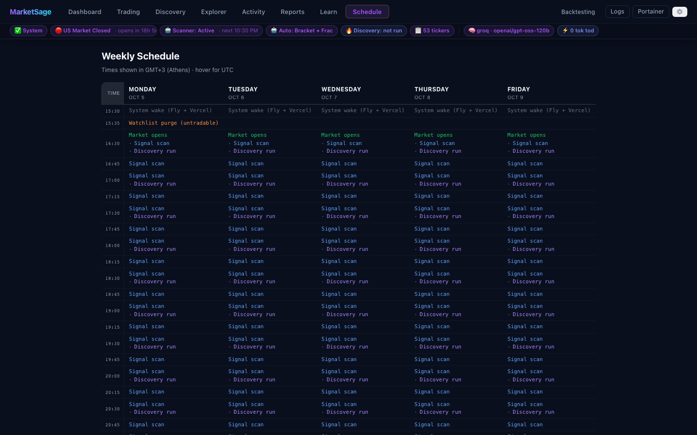

# Schedule

The **🗓 Schedule** page draws the whole trading week as a timetable, so you can see at a
glance when the machine wakes, when scans fire, and when each report goes out — without
reading cron expressions.

> ⚠️ **Not financial advice.** For educational and research use only.

---

## What it shows

A timetable with **one time column on the left** and five day columns (Monday – Friday),
today's column highlighted. Each row is one time slot shared by every day, so the same
event lines up horizontally across the week. When two events fall in the same minute
(typically a signal scan and a discovery run) they share one cell, each in its own colour.
A red line marks the current time.

| Event | Day(s) | Notes |
|---|---|---|
| System wake (Fly + Vercel) | Mon–Fri | Cloudflare cron starts the backend and restores the Vercel alias (1 h before the open) |
| Watchlist purge | Monday only | Removes persistently untradable tickers (≥ 5 drops in 7 days, zero signals). See [Watchlist hygiene](settings.md#watchlist-hygiene). |
| Market opens | Mon–Fri | US market open (09:30 ET) |
| Signal scan | Mon–Fri | Every slot shown; spacing is `scan_interval_minutes` |
| Discovery run | Mon–Fri | Every run shown; interval read live from `GET /settings/discovery` (shown whether or not discovery is enabled) |
| Market closes | Mon–Fri | US market close (16:00 ET) |
| EoD report | Mon–Fri | `GET /reports/eod/orders` + `GET /reports/eod/frac` |
| End-of-Week report | Friday only | `GET /reports/weekly/orders` + `GET /reports/weekly/frac` |
| System stop (Fly + Vercel) | Mon–Fri | Cloudflare cron stops the backend and removes the Vercel alias |

Because the scan cadence and discovery interval are read live, changing them in
**Settings** redraws the table on the next load. Hover a time to see its UTC equivalent.

---

## Time zones

Times render in **Europe/Athens** (the author's local zone) and each entry shows its
**UTC** equivalent on hover. The underlying schedule is anchored to US Eastern — the
market hours and the Cloudflare crons are both ET-based — so during the few weeks each
year when US and EU daylight-saving transitions are out of step, the displayed local
times shift by an hour while the ET times stay fixed.

---

## Relationship to the two schedulers

Two independent schedulers drive the events on this page, and it helps to know which
owns what:

- **Cloudflare Workers cron** — owns the machine lifecycle (wake/stop) and triggers the
  four report endpoints. It runs even while the Fly machine is stopped, which is what
  makes the wake possible. See [cloudflare-cron.md](cloudflare-cron.md).
- **In-process `MonitorScheduler`** — owns signal scans, discovery runs, paper-order
  sync, and fractional exit monitoring. It only runs while the machine is up, so its
  events are always bounded by the wake and stop times above.

A consequence worth remembering: if the machine never wakes, no scans happen *and* the
report endpoints fail, because they are served by the very app that is still stopped.

Between the stop and the next wake the site itself is offline too:
`offgrid-trader.vercel.app` returns `DEPLOYMENT_NOT_FOUND` until the morning start
re-points it. This page is therefore only reachable while the app is awake.

---

## Related

- [Cloudflare cron](cloudflare-cron.md) — the schedules themselves, and how to change them
- [Reports](reports.md) — what each of the four reports contains
- [Settings](settings.md) — scan interval and discovery cadence
